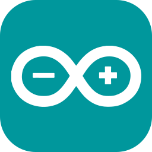
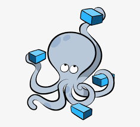

### 👋 About me

I'm an open source enthusiast who enjoys securing systems, networks and software – and testing how secure they really are.

- 🔭 I'm currently studying Computer Science at the University of Applied Sciences Brandenburg.
- 🌐 My Website: [Sebastian Feustel](https://www.sebastian-feustel.de/)
- 📚 My Blog: [Hackwiki](https://www.hackwiki.de/)
- 📣 Doing Public Relations at [Brandenburger Linux User Group](https://www.bralug.de/) 🐧.
- 👯 Sometimes you can meet me at [Chaostreff Potsdam](https://www.ccc-p.org/) 🚀.
- ⚡ Fun fact: These days you’ll find me more often at the gym 🏋️ than in the pool 🏊‍♂️.

### 🚀 Featured Projects

| Project | Description |
|---|---|
| 📦 [Packer Debian for Proxmox VE](https://github.com/53845714nF/packer-proxmox-debian) | Packer templates for a Debian base image (with Salt Minion) on Proxmox VE. |
| 🚩 [VulnHub to Proxmox VE](https://github.com/53845714nF/vuln2pve) | Downloads VMs from VulnHub and converts them to the Proxmox format – for CTF players with a Proxmox lab. |
| 🔑 [Hasura JWT](https://github.com/53845714nF/hasura-jwt) | Go service that issues JWTs for the Hasura GraphQL engine, with optional email signup. |
| 🦕 [Dinofind 2](https://github.com/53845714nF/dinofind2) | Website for finding visually similar images. |
| 🗜️ [DINOv3 to ONNX](https://github.com/53845714nF/dinov3_research_onnx) | Converts the DINOv3 model to ONNX and validates its performance. |
| 🏛️ [OPA for Ceph](https://github.com/53845714nF/OPA_for_ceph) | Open Policy Agent in a Ceph multi-site setup to enforce data-sovereignty storage policies. |
| 🕵️ [Stegano AI](https://github.com/53845714nF/steganoai) | Detects hidden Unicode characters in LLM-generated text. |
| ⌨️ [Uniclass KVM Switcher](https://github.com/53845714nF/Uniclass_KVM) | Switches a Uniclass KVM via USB – based on my [reverse engineering](https://github.com/53845714nF/Reverse_Engineering_KVM_Switch) of its signal. |

### 🔨 Practical knowledge

  Click👆

<table>
	<tr>
		<th> Property </th>
	 	<th> Data </th>
	</tr>
	<tr>
		<td>Programming languages</td>
		<td>
			

				
				
				
				
					
				
				
			

		</td>
	</tr>
	<tr>
		<td>Web Technologies</td>
		<td>
			

				
				
			

			

				
				
				
			

			

				
				
				
			

		</td>
	</tr>
	<tr>
		<td>Databases</td>
		<td>
			

				
				
				
				
				
			

		</td>
	</tr>
	<tr>
		<td>DevOps</td>
		<td>
			

				
				
				
				
			

			

				
				
				
				
			

			

				
				
				
			

			

				 
				
			

			

				 
				
			

			

				
				
			

    	</td>
    </tr>
	<tr>
		<td>Security Tools</td>
		<td>
			

				
				
				
				
			

		</td>
	</tr>
</table>

